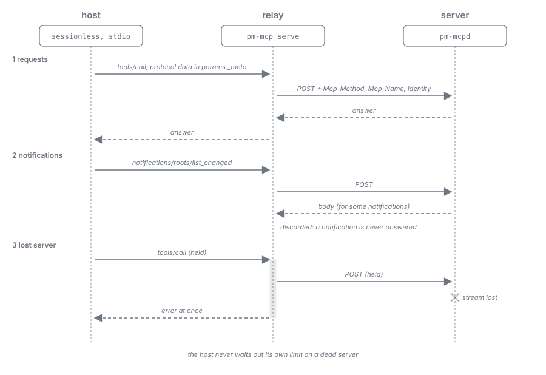

= Runtime & Interaction Model Specification: Relay
:toc: left
:toclevels: 3
:toc-title: Table of Contents
:sectnums:
:source-highlighter: highlight.js
:nofooter:

link:../../Specification.adoc[Specification] » link:../runtime-model.adoc[Runtime & Interaction Model Specification] » Relay

== Relay (`pm-mcp serve --job`)
_See Requirement link:../../Requirements.adoc#PM-SEC-4[PM-SEC-4: Local Transport Isolation, Operator-Gated Network Exposure & Stream Hygiene]_

_See Requirement link:../../Requirements.adoc#PM-TOOL-5[PM-TOOL-5: Tool Schema Stability & Context Budget Discipline]_

_See Requirement link:../../Requirements.adoc#PM-DIST-3[PM-DIST-3: Worker MCP Connection per Launch]_

The relay is the only way a worker reaches the runtime's MCP endpoint. It carries the worker's job token and generation, so that a model never sees, passes, or invents them, and it keeps the harness's view of the runtime consistent when a stream or the runtime is lost. No client of the operator and no host session uses it: the operator works only in the web app and the terminal client, over the local API (link:01-processes-and-transport.adoc#local-api[Local API]). The measurements behind its rules are recorded in the link:../evaluation.adoc[Evaluation Reference].

=== Contract

* *One mode*: `pm-mcp serve --job --socket <path>` is the relay of a worker; only the MCP configuration the runtime composes for a worker's launch starts it (link:../model-work/04-worker-launch.adoc[Model Work Specification, Worker Launch]). `pm-mcp serve` started without `--job`, or without `PM_MCP_JOB_ID` and `PM_MCP_JOB_TOKEN` in its environment, exits at once with a diagnostic on `stderr`, so no host configuration and no project's own MCP configuration can open a connection to the runtime.
* *Transparent otherwise*: The relay is a JSON-RPC 2.0 message relay. It maps each `stdin` message to a request to the runtime's Streamable HTTP endpoint `/mcp` and writes every message the runtime emits for this connection to `stdout`, preserving JSON-RPC `id` values unchanged. It changes a message only where <<relay-rules,Relay Rules>> say so; it does not render representations, interpret tool results, or hold workflow state.
* *Stream hygiene*: `stdout` carries only newline-delimited JSON-RPC 2.0 messages, each serialized as one UTF-8 line and flushed immediately. Diagnostics go to `stderr` only (`PM-SEC-4`).
* *Credentials*: The relay holds the job token only: it reads it from `PM_MCP_JOB_TOKEN`, sends it as `PM-MCP-Job-Token`, connects to the socket path the runtime put into the worker's MCP configuration, reads no file of `<PM_MCP_BASE>` (outside its job-private directory a worker cannot), and never starts the runtime; a `401` (unknown or malformed token), or a `generation_fenced` or `job_ended` answer to a revoked one, ends it with a diagnostic on `stderr` (link:01-processes-and-transport.adoc#job-token[Local Trust: Job Token]). The token never reaches `stdout`, `stderr`, or the harness's model. The relay starts no job.
* *Build*: The relay is the `serve` command of the relay binary `pm-mcp` (module `pm-relay`: plain native image, no Quarkus, no MCP server). Its startup budget is defined in `PM-TECH-3`.

=== Host Protocol Forms
_Implementation watch: link:../../implementation-watch/runtime-model.adoc#PM-WATCH-RUN-16[PM-WATCH-RUN-16]_

A worker's harness reaches a server in one of two forms, and the relay serves both while it always talks to the runtime without an MCP session:

* *Sessionless harnesses* (MCP `2026-07-28`; Claude Code and Antigravity): the harness first sends `server/discover` and then every request on its own, with the protocol data in `params._meta` of each request under the keys `io.modelcontextprotocol/protocolVersion`, `io.modelcontextprotocol/clientInfo`, and `io.modelcontextprotocol/clientCapabilities`. Claude Code falls back to `initialize` when discovery fails.
* *Session-opening harnesses* (MCP `2025-11-25`; OpenCode): the harness sends `initialize` and `notifications/initialized` once and then its requests.

The runtime answers `server/discover` and `initialize` itself and keeps nothing per connection (`PM-ARCH-4`):

* *`server/discover`*: A request without `params._meta` carrying the three protocol keys above is refused with HTTP `400`; the relay forwards the harness's `_meta` unchanged.
* *`initialize`*: The runtime issues no session. The Quarkus MCP server attaches an `Mcp-Session-Id` to every `initialize` response; a response filter of the runtime removes the header before the response leaves the runtime, and every later request, which arrives without a session, is served through the server's automatic initialization (`quarkus.mcp.server.http.streamable.auto-init`).
* *Capabilities*: The capabilities in the `server/discover` result and the `initialize` result are those the Quarkus MCP server declares, `tools.listChanged: true` among them; the server has no setting for it and the runtime leaves them unchanged. The declaration announces nothing the runtime does: its tool, resource, and prompt surface is fixed per connection, so it never sends a list-changed notification (<<_messages_from_runtime_to_host,Messages from Runtime to Host>>).
* *`subscriptions/listen`*: The Quarkus MCP server acknowledges a harness's `subscriptions/listen` at once (`notifications/subscriptions/acknowledged` on the SSE response) and holds that stream open without a final response; the runtime sends nothing on it. An open, silent listen stream is harmless: every next step arrives in the answer to the worker's own call, so the worker waits for nothing on it, and its other requests are served beside it. A runtime restart ends the listen stream of every open connection. A harness is expected to open the listen again or to go on without it; this behaviour is not yet verified and is checked per harness with the always-on runtime (link:../../roadmap.adoc#_milestone_2_always_on_runtime_stdio_relay_process_coordination_operator_channel[Roadmap, Milestone 2]). For a harness that fails on the ended stream, the relay answers the listen locally and keeps it open across runtime restarts.

The relay records the protocol data of the harness's `initialize`, or takes it from each request's `params._meta`, and sends it with every forwarded request (<<_connection_metadata,Connection Metadata>>), so every request is self-describing and a runtime restart loses only the requests in flight.

=== Connection Metadata

The relay sends the following HTTP headers on every request it forwards. The runtime evaluates them per request in its authentication mechanism (the `quarkus-security` extension, without which the mechanism and the identity providers stay inert), which turns them into the request's security identity; tool and resource handlers read that identity through the current request (`CurrentVertxRequest`) and never an HTTP header, because headers do not reach a handler of the Quarkus MCP server. The connection metadata never travels in `params._meta`.

*Header encoding*: Every header value is ASCII. The JSON-valued headers (`PM-MCP-Client-Info`, `PM-MCP-Client-Capabilities`) carry compact JSON with every non-ASCII character escaped as `\uXXXX`.

[cols="1,3"]
|===
|Header |Content

|`PM-MCP-Job-Token`
|The worker's job token (link:01-processes-and-transport.adoc#job-token[Local Trust: Job Token]).

|`Mcp-Method`, `Mcp-Name`
|The JSON-RPC method of the message and, for a call by name (`tools/call`), the tool name, derived by the relay from each message, because the runtime's transport refuses a `2026-07-28` request without them and a sessionless harness does not send them. The runtime's response filter for `initialize` (<<_host_protocol_forms,Host Protocol Forms>>) takes the method from `Mcp-Method` and, for a request that arrives without the header, from the JSON-RPC body, so no `initialize` passes it unseen.

|`PM-MCP-Relay-Version`
|The relay binary's version (for mismatch detection, link:02-startup-recovery-drain.adoc#runtime-lifecycle-operations[The Runtime's Lifecycle], Versions apart).

|`PM-MCP-Protocol-Version`, `PM-MCP-Client-Info`, `PM-MCP-Client-Capabilities`
|The protocol version, `clientInfo`, and capabilities (for example progress and the client capability of the MCP Skills Extension) of the harness, from its `initialize` request or from the request's `params._meta`; the runtime derives every capability-dependent behaviour from these values on each request (link:04-sessions-and-workers.adoc#_connection_scoped_rendering[Connection-Scoped Rendering]).

|`PM-MCP-Generation`
|The worker's generation (<<_generations_at_the_relay,Generations at the Relay>>).
|===

The runtime takes the project (or the machine scope for a task of the machine scope), the role, the client profile of the worker's harness, and the leased task entities from the job record and the task queue, for a tool call and for `resources/list` and `resources/read` alike, never from a header or an argument (`PM-ARCH-4`).

=== Generations at the Relay
_See Requirement link:../../Requirements.adoc#PM-WORK-2[PM-WORK-2: Task Protocol]_

A generation identifies one worker; tasks are leased to it, and every call of a fenced generation is refused (`generation_fenced`). Its semantics are those of the task protocol (link:../model-work/02-task-protocol.adoc[Model Work Specification, Task Protocol]); this section defines how the relay comes to carry one.

* *The worker's generation*: The generation is the worker's `job_id`, read from `PM_MCP_JOB_ID`. A harness that kills and restarts its `stdio` server mid-task (Claude Code does so by itself) starts a new relay with the same environment, so the new relay carries the same generation, and the runtime binds it as long as that generation is not fenced. The relay never asks for another generation, and there is no other kind of generation.
* *Fencing*: The supervisor fences a worker's generation when it ends or replaces the worker, and the recovery and the drain fence the generations of the workers they settle (link:../model-work/03-supervision-and-recycling.adoc[Model Work Specification, Supervision & Recycling]); the task leases of a fenced generation are released and their tasks offered again (link:../model-work/02-task-protocol.adoc[Model Work Specification, Task Protocol]). Every later request of a fenced generation reaches its handler and is refused with `generation_fenced` (link:../mcp-tools/04-errors-and-testing.adoc[MCP Tools Specification, Errors]), and the relay ends.
* *One loop per relay*: The runtime tells loops apart only by the generation their relay carries; within one generation it never offers a leased task to a second concurrent `pm_wait`.

[#relay-rules]
=== Relay Rules
_See Requirement link:../../Requirements.adoc#PM-ARCH-3[PM-ARCH-3: STDIO Host Transport, Local Relay & Frontier Protocol Compliance]_

_Implementation watch: link:../../implementation-watch/runtime-model.adoc#PM-WATCH-RUN-10[PM-WATCH-RUN-10], link:../../implementation-watch/runtime-model.adoc#PM-WATCH-RUN-11[PM-WATCH-RUN-11]_

The relay changes the message stream only by these rules:

. *Add the transport headers*: It derives `Mcp-Method` and `Mcp-Name` from each message and sends them with the headers of <<_connection_metadata,Connection Metadata>>.
. *Never answer a notification*: It forwards a harness notification and discards whatever the runtime's transport returns for it (the transport returns a body for some notifications of a sessionless harness, for example `notifications/roots/list_changed`); nothing reaches `stdout` for a notification, because a harness may end the server on an unexpected message.
. *Report a lost runtime at once*: When its stream to the runtime is lost, or the runtime does not accept connections within the runtime start timeout (link:../timeouts/02-runtime-leases-operator-web.adoc#runtime-start-timeout[Timeouts & Budgets Specification]), it answers every pending request at once with a JSON-RPC error carrying the closed code `runtime_unavailable` (link:../mcp-tools/04-errors-and-testing.adoc#relay-transport-codes[MCP Tools Specification, Relay and Transport Codes]), so a harness never waits out its own limit on a dead server; it keeps retrying on subsequent requests.
. *Ignore a cancellation of an answered request*: It drops a harness's `notifications/cancelled` whose `requestId` it has already answered (a harness may cancel every call after its answer); the runtime likewise ignores a cancellation of a request it has answered.
. *Hide identity arguments*: It removes every property of the closed identity set (`generation_id`, `role`, `worker`, `job_token`) from the `inputSchema` of every tool in a `tools/list` result before writing it to `stdout`, and drops such an argument from a harness's `tools/call` before forwarding it. Identity, role, and generation travel only in the relay's headers; the runtime's own tool schemas declare none, and a value a model invents is never forwarded.
. *Tolerate a restart*: It holds no state a restart could lose: a relay started again by its harness reads its token and generation from its environment again and binds to the same generation (<<_generations_at_the_relay,Generations at the Relay>>).

== Request and Response Flow

=== Normal Call

[source,text]
----
Worker harness      pm-mcp serve --job (relay)       pm-mcpd runtime
 │ stdin: request id=7    │                                │
 ├───────────────────────▶│ POST /mcp (job token, Mcp-*,   │
 │                        │  PM-MCP-* headers)             │
 │                        ├───────────────────────────────▶│ bind job, lock, validate,
 │                        │                                │ transition, persist, render
 │                        │◀───────────────────────────────┤ response id=7 (JSON or SSE event)
 │ stdout: response id=7  │                                │
 │◀───────────────────────┤                                │
----

Each harness request receives exactly one response with its own `id`.

=== Messages from Runtime to Host

* *Progress notifications* (`notifications/progress`) related to a pending call arrive on that call's SSE response stream. The relay writes them to `stdout` in arrival order.
* *No elicitation*: MCP elicitation is never used. No state asks anything through MCP: what needs the operator is an operator wait served to the operator's clients (link:../workflow-dsl/02-units-jobs-decisions.adoc#operator-wait[Workflow DSL Specification, Waiting for the Operator]), and a worker's question is the `ask` link of its task (link:../hypermedia-format/01-representation-and-link-forms.adoc#question-waiver-and-exit-links[Hypermedia Format Specification, Task, Question & Waiver-Request Links]).
* There are no messages unrelated to a pending call: the runtime's tool, resource, and prompt surface is fixed per connection and every next step arrives in the answer to the worker's own call, so there is nothing to announce. Without sessions the runtime opens no standalone SSE stream (`GET /mcp`), sends nothing on a harness's `subscriptions/listen` stream after its acknowledgement, and offers no resource subscriptions or `list_changed` notifications (<<_host_protocol_forms,Host Protocol Forms>>). Workers detect changed skills through their content digest (link:../mcp-tools/02-service-and-skill-tools.adoc[MCP Tools Specification, Skill Tools]). A task reaches a worker only as the answer to its pending `pm_wait` (link:../mcp-tools/01-core-workflow-tools.adoc[MCP Tools Specification, `pm_wait`]).

=== Cancellation

A harness's `notifications/cancelled` for a pending call is forwarded to the runtime and cancels only that call. A cancelled `pm_wait` ends without consuming a task: a task is leased only with the offer that answers a wait, never before. A cancelled `pm_build` wait leaves the build running. A cancellation never cancels a job: jobs are cancelled only by the engine (a short-circuited composite wait, a fenced worker, a pause with the point _now_) and by the operator's acts that end a scope (`PM-WF-8`). A cancellation of a request already answered is ignored (<<relay-rules,Relay Rules>>, rule 4).
